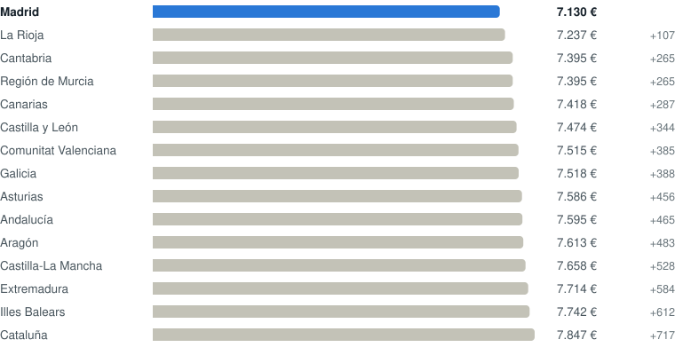

# Mi nómina de profesor, euro a euro

Soy profesor de Secundaria interino en un instituto público de la Comunidad de Madrid y doy clase en Formación Profesional. Mi sueldo se paga con dinero público, así que aquí está entero, con cada concepto explicado.

**[Abrir la página interactiva](https://joseluis-m.github.io/nomina-docente-madrid/)**

Los datos son de mis nóminas de septiembre y octubre de 2026, que son idénticas. No hay datos personales ni mi retención de IRPF. Las cifras están contrastadas con la normativa vigente el 13 de noviembre de 2026.

## Un mes

| | Euros al mes |
|---|---:|
| Sueldo bruto | 2.914,79 |
| Cotizaciones a la Seguridad Social que pago yo | 215,29 |
| **Lo que cobro antes de IRPF** | **2.699,50** |
| Cotizaciones que paga la Administración | 1.058,20 |
| **Lo que cuesta mi puesto** | **3.972,99** |

El bruto se compone de sueldo (1.387,24 €), complemento de destino (729,14 €) y complemento específico general docente (798,41 €). En junio y diciembre se suma una paga extra de 2.383,60 €, así que el bruto de un año completo es de 39.744,68 €. En la página se explica cada concepto y cada cotización.

## A dónde va cada euro

En un año completo, con las cuantías de 2026, mi puesto cuesta 52.443 €. Para repartirlos uso el IRPF de un caso tipo, una persona soltera, sin hijos y menor de 65 años, porque el mío depende de mi situación personal y no lo publico.

<picture>
  <source media="(prefers-color-scheme: dark)" srcset="assets/reparto-oscuro.svg">
  
</picture>

Con ese IRPF, de cada 100 € que cuesta el puesto llegarían 57 a mi cuenta. Los otros 43, unos 22.400 € al año, son IRPF y cotizaciones a la Seguridad Social. Con las cotizaciones se pagan las pensiones, el desempleo y las bajas. Como soy empleado público, todo el coste se paga con dinero público, que sale sobre todo de los impuestos, también de los míos.

## El IRPF cambia según la comunidad

Con un sueldo como este, el caso tipo paga en Madrid 7.131 € de IRPF al año. Es la cuota más baja de las quince comunidades de régimen común. La media de las otras catorce es de 7.549 €, 418 € más, y la más alta es la de Cataluña, con 7.848 €.

<picture>
  <source media="(prefers-color-scheme: dark)" srcset="assets/irpf-oscuro.svg">
  
</picture>

El País Vasco y Navarra tienen un régimen fiscal propio y no entran en el gráfico. Con este mismo sueldo, en el País Vasco se pagarían 7.046 €, 85 € menos que en Madrid. En Navarra, según el Consejo General de Economistas, se paga algo menos que en Madrid con 30.000 € y más con 45.000 €.

Andalucía, Galicia y Canarias tramitan con sus presupuestos de 2027 rebajas que se aplicarían ya a las rentas de 2026. No están aprobadas y por eso no se incluyen.

En la página interactiva se puede mover el sueldo y ver cómo cambia el resultado.

## Lo que estos datos no dicen

- El sueldo bruto tampoco es igual en todas las comunidades. Según UGT, en 2025 un profesor de Secundaria sin antigüedad cobraba en Madrid 2.801,66 € al mes, en la parte media baja de la tabla. La página incluye la comparación completa.
- El IRPF real de cada persona depende de su situación y de las deducciones de su comunidad, que este cálculo no incluye. El caso tipo sirve para comparar comunidades, no para saber lo que paga nadie en concreto.
- El coste de la vida no está aquí. La vivienda, por ejemplo, cuesta muy distinto en Madrid que en otras comunidades.
- Menos impuestos autonómicos son también menos ingresos para la comunidad. Si compensa o no es una cuestión de opinión, y cada uno tendrá la suya.

## Fuentes

- Mi nómina de septiembre de 2026, que no publico porque contiene datos personales.
- [Orden de 3 de febrero de 2026](https://www.bocm.es/boletin/CM_Orden_BOCM/2026/02/09/BOCM-20260209-6.PDF) de la Comunidad de Madrid sobre nóminas, y tablas de [ANPE Madrid](https://documentos.anpemadrid.es/retribuciones_26.pdf) y de [STEM](https://stemstes.org/wp-content/uploads/2026/02/RETRIBUCIONES-BASICAS-2026.pdf).
- [Real Decreto-ley 14/2025](https://www.boe.es/diario_boe/txt.php?id=BOE-A-2025-24445), con las subidas de 2025 y 2026, y [Estatuto Básico del Empleado Público](https://papelea.com/es/leyes/estatuto-basico-del-empleado-publico-ebep/titulo-iii_capitulo-iii), artículos 22 a 25.
- [Orden PJC/297/2026](https://www.boe.es/eli/es/o/2026/03/30/pjc297), de cotización a la Seguridad Social para 2026.
- [Manual práctico de Renta 2025](https://sede.agenciatributaria.gob.es/Sede/ayuda/manuales-videos-folletos/manuales-practicos/irpf-2025/c15-calculo-impuesto-determinacion-cuotas-integras/gravamen-base-liquidable-general/gravamen-autonomico.html), de la Agencia Tributaria, y [Tributación autonómica. Medidas 2026](https://www.hacienda.gob.es/sgfal/financiacionterritorial/autonomica/capitulo-i-tributacion-autonomica-2026.pdf), del Ministerio de Hacienda, para las escalas de cada comunidad.
- [Ley 5/2026](https://www.boe.es/eli/es-vc/l/2026/07/31/5) de la Comunitat Valenciana y [Ley 2/2026](https://www.boe.es/diario_boe/txt.php?id=BOE-A-2026-17839) de Extremadura, que rebajan sus escalas de 2026.
- [Panorama de la fiscalidad autonómica y foral 2026](https://multimedia2.coev.com/pdfs/panorama-fiscalidad2026.pdf), del Consejo General de Economistas.
- [Retribuciones docentes en la enseñanza pública 2025](https://ugt-sp.es/wp-content/uploads/boletin-retribuciones-docentes-2025-web.pdf), de UGT.

La página interactiva explica el método de cálculo y enlaza el resto de fuentes.

## Por qué publico esto

Trabajo en el sector público y me parece razonable que cualquiera pueda ver cuánto cuesta mi puesto y a dónde va ese dinero. Cuando se habla de sueldos casi siempre se discute el bruto o el neto, y pocas veces el coste completo o los impuestos que hay por el camino.

No pretendo convencer a nadie. Creo que con los datos delante cada uno puede sacar sus propias conclusiones. La mía es que es un trabajo bien pagado y que estoy en él por vocación.

Puedes reutilizar estos datos citando la fuente (licencia CC BY 4.0).
